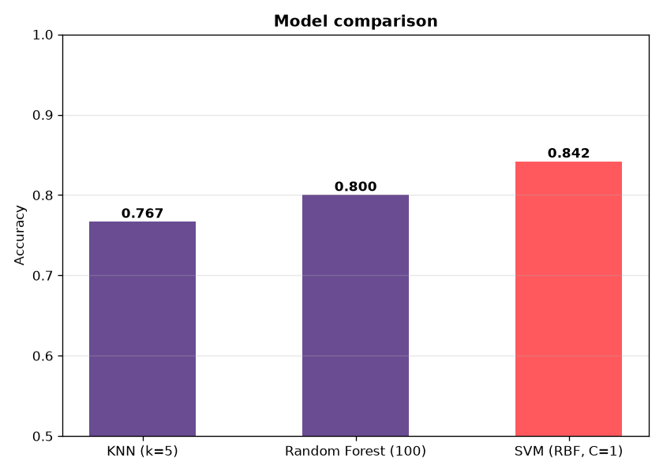
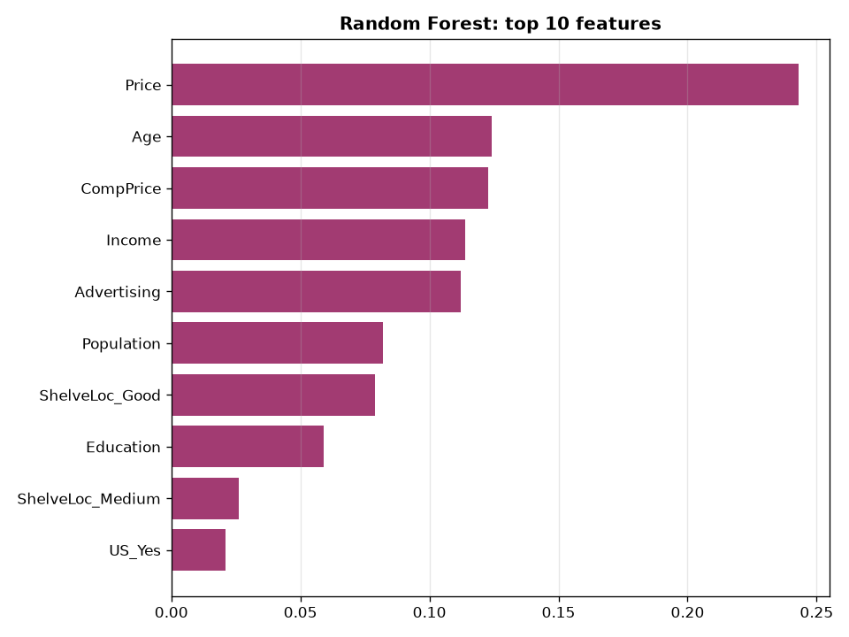
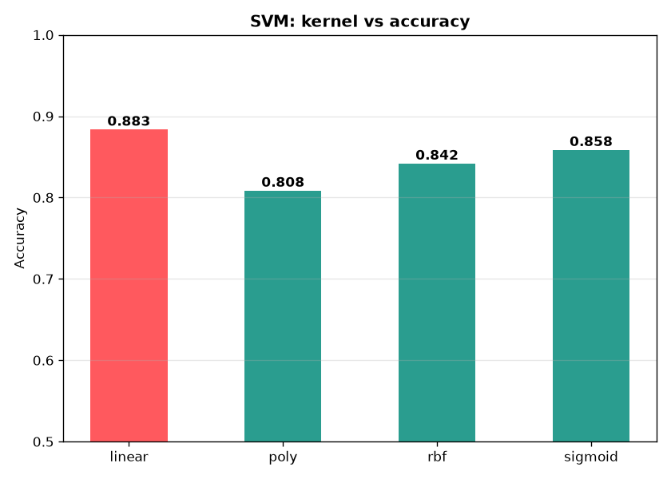
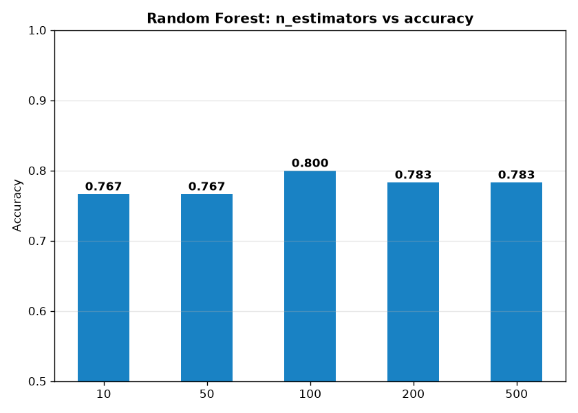
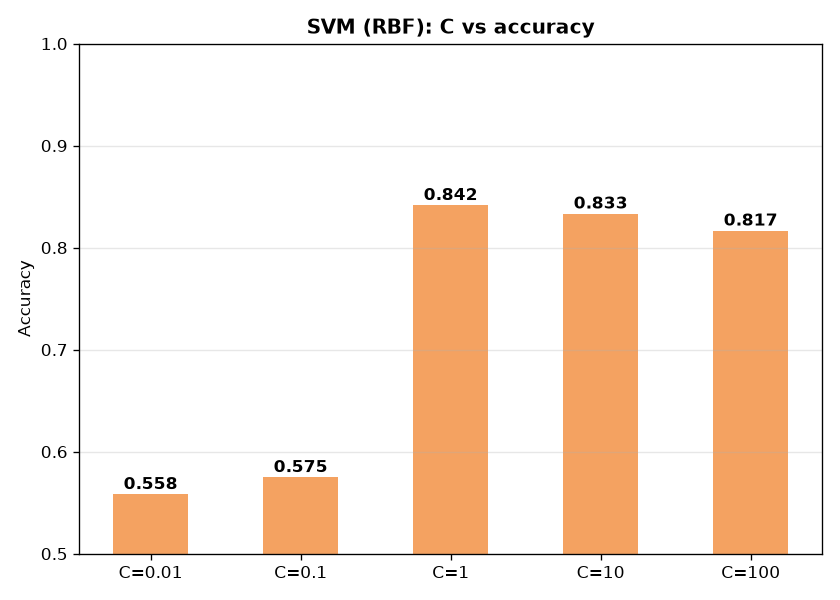
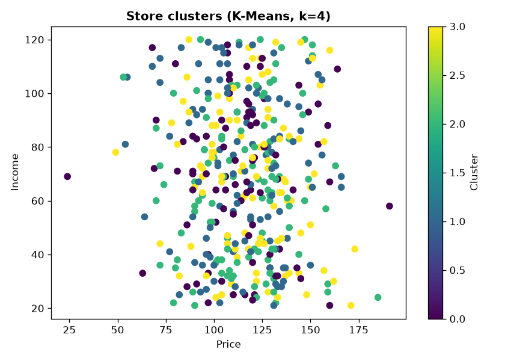
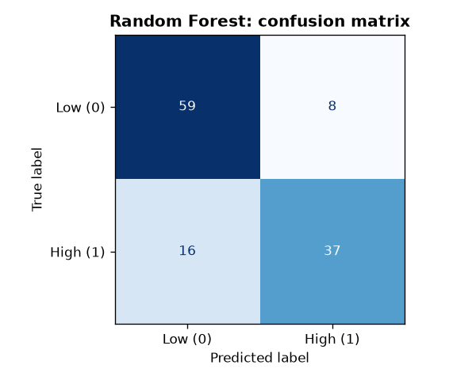

# Carseats ML

A classical machine-learning study on the ISLR **Carseats** dataset: predicting
whether a store sells more than 8 units per unit area (`High = Sales > 8`) and
segmenting stores with K-Means.

## Results

70/30 train-test split, `random_state=0`, standardized features.

| Model | Accuracy |
| --- | ---: |
| SVM (linear) | 0.883 |
| SVM (RBF, C=1) | 0.842 |
| Random Forest (100 trees) | 0.800 |
| KNN (k=5) | 0.767 |



## What the study covers

- **K-nearest neighbours** baseline (k=5).
- **Random Forest** with a sweep over the number of trees (10 to 500) and a
  feature-importance analysis.
- **Support Vector Machine** with a sweep over the kernel (linear, poly, RBF,
  sigmoid) and over the regularization strength `C`.
- **K-Means** clustering of stores on price and income.
- One shared, reproducible preparation step: threshold target, one-hot encoding,
  train/test split and standardization.

## Key findings

- The **linear SVM** is the strongest classifier at **0.883**, ahead of the RBF
  kernel (0.842) and the Random Forest (0.800).
- **Price** is the dominant predictor (importance 0.243), followed by Age,
  CompPrice and Income.
- K-Means splits the stores into four price/income clusters.

## Figures

| | |
| --- | --- |
|  |  |
|  |  |
|  |  |

## Project structure

```text
carseats_ml/       reusable package: data loading, model factories, evaluation
notebooks/         analysis.ipynb — the executed narrative
scripts/           run_experiments.py — reproduces every result and figure
data/              carseats.csv (provenance in data/README.md)
reports/figures/   figures generated by run_experiments.py
tests/             pytest suite for the package
```

## Usage

Set up the environment and install the package:

```text
pip install -e ".[dev]"
```

Reproduce the results and regenerate the figures:

```text
python scripts/run_experiments.py
```

Run the tests and the linter:

```text
pytest
ruff check .
```

## Dataset

`data/carseats.csv` is the **Carseats** dataset from *An Introduction to
Statistical Learning* (James, Witten, Hastie, Tibshirani): 400 store
observations and 11 columns — `Sales`, `CompPrice`, `Income`, `Advertising`,
`Population`, `Price`, `ShelveLoc`, `Age`, `Education`, `Urban` and `US`.
Provenance and license notes are in `data/README.md`.

## Tech stack

Python 3.11+, scikit-learn, pandas, NumPy, Matplotlib, pytest, Ruff, GitHub
Actions.

## License

MIT — see `LICENSE`.
